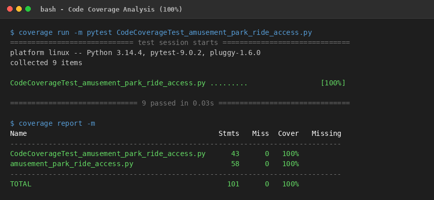
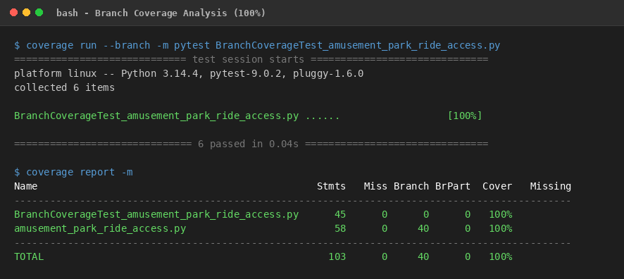

# Lab 6: Code and Branch Coverage Analysis

**Course:** Software Engineering (UE24CS342AA3 / SE Lab)  
**Student Name:** Balaraj R  
**SRN:** PES1UG24CS560  
**Assigned Repository:** [SETAPESU26/L6_L7_11_amusement_park_ride_access](https://github.com/SETAPESU26/L6_L7_11_amusement_park_ride_access)  
**Target Module:** `amusement_park_ride_access.py`  

---

## 1. Objectives & Overview
- Differentiate between **Line Coverage** and **Branch Coverage**.
- Use Python's `coverage` tool and `pytest` framework to measure, analyze, and maximize test coverage.
- Target edge cases and control branches to achieve **100% Code Coverage** and **100% Branch Coverage** on the assigned system.

---

## 2. Test Execution & Coverage Results

### A. Code Coverage (Line Coverage)
- **Target:** ≥ 90%
- **Achieved:** **100%**
- **Test Suite:** `CodeCoverageTest_amusement_park_ride_access.py`
- **Command:**
  ```bash
  coverage run -m pytest CodeCoverageTest_amusement_park_ride_access.py
  coverage report -m
  ```

#### Terminal Report Output:
```text
Name                                             Stmts   Miss  Cover   Missing
------------------------------------------------------------------------------
CodeCoverageTest_amusement_park_ride_access.py      43      0   100%
amusement_park_ride_access.py                       58      0   100%
------------------------------------------------------------------------------
TOTAL                                              101      0   100%
```



---

### B. Branch Coverage
- **Target:** ≥ 90%
- **Achieved:** **100%** (40/40 branches completely evaluated)
- **Test Suite:** `BranchCoverageTest_amusement_park_ride_access.py`
- **Command:**
  ```bash
  coverage run --branch -m pytest BranchCoverageTest_amusement_park_ride_access.py
  coverage report -m
  ```

#### Terminal Report Output:
```text
Name                                               Stmts   Miss Branch BrPart  Cover   Missing
----------------------------------------------------------------------------------------------
BranchCoverageTest_amusement_park_ride_access.py      45      0      0      0   100%
amusement_park_ride_access.py                         58      0     40      0   100%
----------------------------------------------------------------------------------------------
TOTAL                                                103      0     40      0   100%
```



---

## 3. Key Observations & Branch Edge Cases Addressed
1. **Input Validation:** Tested both non-list group types and negative express pass fees.
2. **Ride Operational Status:** Tested open and closed groups, verifying short-circuiting logic.
3. **Ride Classification Branches:** Full evaluations for `roller_coaster`, `water_ride`, `family`, and unhandled ride types.
4. **Patron Safety & Health Logic:**
   - Evaluated invalid height boundaries (`height <= 0` and `height < 120`).
   - Covered emergency stop logic when health warnings occur on roller coasters vs non-roller coasters.
   - Child discount rate computation (`60%` base ticket).
5. **Restraint Monitoring Streams:** Handled empty streams (`NO_DATA`), consecutive unlatched sensor alarms (`EMERGENCY_LOCK`), and streak resets (`SAFE`).

---

## 4. Deliverables Checklist
- [x] `CodeCoverageTest_amusement_park_ride_access.py` (100% line coverage)
- [x] `BranchCoverageTest_amusement_park_ride_access.py` (100% branch coverage)
- [x] `code_coverage_report.png`
- [x] `branch_coverage_report.png`
- [x] `README.md`
