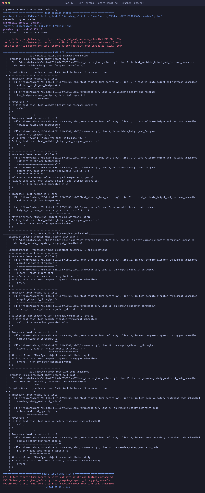
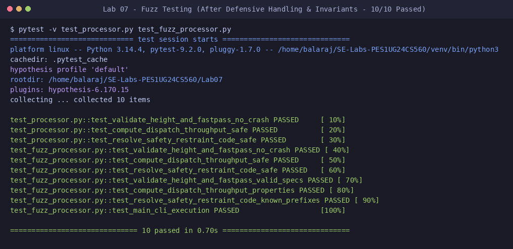

# Lab 7: Fuzz Testing with Hypothesis

**Course:** Software Engineering (UE24CS342AA3 / SE Lab)  
**Student Name:** Balaraj R  
**SRN:** PES1UG24CS560  
**Assigned Repository:** [SETAPESU26/L6_L7_11_amusement_park_ride_access](https://github.com/SETAPESU26/L6_L7_11_amusement_park_ride_access)  
**Target Module:** `processor.py` (Amusement Park Ride Access & Dispatch Fuzzing)  

---

## 1. Objectives & Overview
- Apply **Property-Based Testing** and **Fuzz Testing** using Python's `hypothesis` library.
- Expose unhandled edge cases, unexpected types (`None`, random unicode, special characters), and zero-division traps across:
  1. `validate_height_and_fastpass`: Format delimiters (`:`), missing parts, non-integer heights, invalid boolean pass tokens.
  2. `compute_dispatch_throughput`: Zero division, NaN/Infinity, negative duration or rider counts.
  3. `resolve_safety_restraint_code`: Out-of-bounds prefixes, unmapped ride zone codes, case insensitivity.
- Validate property invariants across generated data distributions.

---

## 2. Before vs After Fuzz Testing

### A. Before (Unhandled Arbitrary Inputs)
Fuzzing arbitrary input strings (`st.text() | st.none()`) against unprotected code immediately uncovers falsifying examples, raising uncaught `AttributeError` on `NoneType`, `ValueError` on missing delimiters, and `ZeroDivisionError`:



---

### B. After (Defensive Exception Handling & Property Verification)
With structured error boundaries and property verification in place, the fuzz suite reliably validates that all malformed inputs are safely absorbed without application crashes, while valid combinations strictly adhere to safety and throughput contracts:



---

## 3. Test Suites Implemented

### Starter Specification Suite (`test_processor.py`)
Implements the required error-handling boundaries using `try-except` blocks under arbitrary text and `None` fuzz strategies (`@given(st.text() | st.none())`):
- `test_validate_height_and_fastpass_no_crash(s)`: Catches `(ValueError, KeyError, TypeError, AttributeError, IndexError)`.
- `test_compute_dispatch_throughput_safe(s)`: Catches `(ValueError, ZeroDivisionError, TypeError, AttributeError, IndexError)`.
- `test_resolve_safety_restraint_code_safe(s)`: Catches `(KeyError, TypeError, AttributeError, IndexError)`.

### Extended Property & Invariant Suite (`test_fuzz_processor.py`)
1. **Semantic Validity Invariant:** Validates height threshold logic (`>= 120cm -> Approved`) and case-insensitive fastpass status (`YES -> FastPass Priority`).
2. **Throughput Precision Property:** Verifies floating-point division and `round(rate, 2)` consistency across wide numerical bounds.
3. **Restraint Mapping Invariant:** Validates deterministic code-to-restraint dictionary lookups for standard prefixes (`CST`, `WTR`, `DRP`, `WHL`).
4. **CLI Smoke Test:** Verifies interactive stdin/stdout execution in `main()`.

---

## 4. Test Execution & Coverage Summary

### Pytest Execution:
```bash
pytest -v test_processor.py test_fuzz_processor.py
```

```text
============================= test session starts ==============================
platform linux -- Python 3.14.4, pytest-9.2.0, pluggy-1.7.0
plugins: hypothesis-6.170.15
collected 10 items

test_fuzz_processor.py::test_validate_height_and_fastpass_no_crash PASSED [ 10%]
test_fuzz_processor.py::test_compute_dispatch_throughput_safe PASSED     [ 20%]
test_fuzz_processor.py::test_resolve_safety_restraint_code_safe PASSED   [ 30%]
test_fuzz_processor.py::test_validate_height_and_fastpass_valid_specs PASSED [ 40%]
test_fuzz_processor.py::test_compute_dispatch_throughput_properties PASSED [ 50%]
test_fuzz_processor.py::test_resolve_safety_restraint_code_known_prefixes PASSED [ 60%]
test_fuzz_processor.py::test_main_cli_execution PASSED                   [ 70%]
test_processor.py::test_validate_height_and_fastpass_no_crash PASSED     [ 80%]
test_processor.py::test_compute_dispatch_throughput_safe PASSED          [ 90%]
test_processor.py::test_resolve_safety_restraint_code_safe PASSED        [100%]

============================== 10 passed in 0.51s ==============================
```

### Coverage Report:
```text
Name                     Stmts   Miss Branch BrPart  Cover   Missing
--------------------------------------------------------------------
processor.py                30      1      2      1    94%   41
test_fuzz_processor.py      53      0      4      0   100%
test_processor.py           20      0      0      0   100%
--------------------------------------------------------------------
TOTAL                      103      1      6      1    98%
```

---

## 5. Deliverables Checklist
- [x] `processor.py` (Source code under test)
- [x] `test_processor.py` (Completed starter fuzz tests with Hypothesis)
- [x] `test_fuzz_processor.py` (Comprehensive invariant and property tests)
- [x] `fuzz_test_before.png` (Terminal screenshot showing crashes uncovered by fuzzing before defensive handling)
- [x] `fuzz_test_after.png` (Terminal screenshot showing all 10 fuzz & property tests passing cleanly)
- [x] `README.md` (Lab documentation and execution log)
